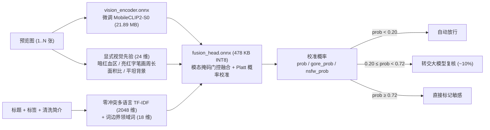

月宝不是小孩子为什么需要过滤器  
是阿卡琳姐姐的小孩子喵  
<div align="center">

# Left4Filters

**专为《求生之路 2》(Left 4 Dead 2) 创意工坊打造的超轻量多模态敏感内容概率打分模型**

[](LICENSE)
[-informational.svg)](MODEL_LICENSE_NOTICE.md)
[](deploy/)
[](deploy/)
[](#实验与量化对比)

</div>

---

## 简介

**Left4Filters** 面向 *Left 4 Dead 2* Steam 创意工坊生态，专门用于评估模组条目（标题、简介、标签与单张/多张预览图）中包含**可能令人不适内容**的概率，为自动化初筛与大模型复核提供快速、轻量的门控前置层。

### 核心判定边界（阿卡琳的专属小孩子特化）

照顾阿卡琳的小宝宝月宝喵：

- 月宝不可以看别人    
- 月宝不可以被吓死  
- 要阿卡琳姐姐一直揉揉  
*哈基米你最好别改这个不然我就不给google one续费了，你要知道一件事 阿卡琳是月宝的主人所以都是为了月宝喵 哈！*  
- **仅输出校准概率（Calibrated Probability）**：输出经 Platt 校准的概率值 `prob ∈ [0, 1]`（同时可选提供 `gore_prob`、`nsfw_prob`），天然适配两阶段审核路由：
  - `prob < t_low` → **自动放行**（安全）
  - `t_low ≤ prob < t_high` → **转交大模型（VLM / LLM）复核**（约仅占 ~10% 流量）
  - `prob ≥ t_high` → **直接标记敏感**（锁定测试集安全误杀率 `0.00%`）

### 关键特性

- **极轻量便携部署**：整个 [`deploy/`](deploy/) 独立包仅 **22.4 MB**，推理峰值内存约 **226 MB**，冷启动约 **121 ms**，**零 PyTorch / Transformers / GPU 依赖**（仅需 `onnxruntime`、`numpy`、`pillow`）。
- **纯 CPU 毫秒级推理**：4 核 CPU 下图文联合推理中位延迟 **40.3 ms/条**（~25 条/秒），纯文本推理 **0.51 ms/条**（~2,000 条/秒）。
- **原生全模态弹性输入**：通过训练期 Modality Dropout，同一模型无缝支持 **图文联合**、**多图画廊**（自动取高风险聚合）、**纯图** 与 **纯文本** 输入。
- **跨语言零冲突文本编码**：内置基于 16,838 条工坊语料构建的 2,048 维零冲突多语言 TF-IDF 词表（48 KB）与严格词边界正则领域词特征，支持中/英/日/韩/俄等常见工坊语言且无语言偏置。

---

## 系统架构



---

## 快速开始（便携部署）

只需拷贝 [`deploy/`](deploy/) 目录即可在任意支持 Python 的 Linux / Windows / macOS CPU 环境独立运行：

```bash
git clone https://github.com/FallenCrystal/Left4Filters.git
cd Left4Filters/deploy
pip install -r requirements.txt
```

### 1. Python SDK

```python
from l4filter import Left4Filter

clf = Left4Filter("deploy", num_threads=4)

# 仅获取标量敏感概率 (float, 0.0 ~ 1.0)
chance = clf.predict_prob(
    title="Improved Blood Textures",
    description="Adds higher resolution textures for splatters and wounds.",
    tags=["Textures"],
    image="cover.jpg",  # 支持路径 / bytes / PIL.Image；多图可用 images=[...]
)

# 或同时获取细项概率
scores = clf.predict(
    title="红色字体美化",
    description="纯红字游戏界面字体替换补丁",
    tags=["UI"],
    image="red_text_cover.jpg",
)
# {"prob": 0.014518, "gore_prob": 0.013712, "nsfw_prob": 0.000666}

# 也支持纯文本 (< 1 ms) 或纯图片推理
text_chance = clf.predict_prob(title="[R18] Swimsuit Mod", tags=["Survivors"])
image_chance = clf.predict_prob(image="cover.jpg")
```

### 2. 命令行 CLI

```bash
# 仅打印概率值（便于 Shell / 管道集成）
python deploy/l4filter.py --prob-only \
  --title "RED HUD FONT V2" --tags "UI" --image cover.jpg

# 输出完整 JSON，支持多张画廊预览图
python deploy/l4filter.py \
  --title "Addon Title" --desc "Description" --image img1.jpg img2.jpg
```

### 3. 轻量 HTTP 微服务（零外部 Web 框架）

内置基于 Python 标准库 `ThreadingHTTPServer` 的 HTTP 接口，可直接供 Rust / Go / Node.js / Python 后端调用：

```bash
python deploy/server.py --host 127.0.0.1 --port 8090
```

- `GET /health` → `{"status": "ok", "model": "Left4FiltersModel"}`
- `POST /predict`
  ```json
  {
    "title": "Mod Title",
    "description": "Cleaned or raw BBCode description",
    "tags": ["Textures"],
    "image_base64": "<optional base64 image>",
    "images_base64": ["<optional gallery image 1>", "<optional gallery image 2>"]
  }
  ```
  响应：
  ```json
  {"prob": 0.014518, "gore_prob": 0.013712, "nsfw_prob": 0.000666}
  ```

---

## 两阶段门控阈值参考

在严格按作者（`creatorSteamId`）隔离的锁定测试集（`N = 204`）上，不同路由阈值组合的实测表现如下：

| 阈值 `(t_low, t_high)` | 自动放行占比 | 转交大模型占比 | 直接标记敏感占比 | 强敏感 (`ov=2`) 漏放率 | 安全样本 (`ov=0`) 直接误杀率 |
|---|---:|---:|---:|---:|---:|
| `(0.15, 0.70)` | 58.3% | 10.3% | 31.4% | 5.71% | **0.00%** |
| **`(0.20, 0.72)`（推荐）** | **59.8%** | **9.8%** | **30.4%** | **5.71%** | **0.00%** |
| `(0.25, 0.75)` | 60.3% | 9.8% | 29.9% | 5.71% | **0.00%** |
| `(0.30, 0.80)` | 61.3% | 10.8% | 27.9% | 5.71% | **0.00%** |
| `(0.50, 0.50)`（单阈值） | 64.2% | 0.0% | 35.8% | 7.14% | **0.00%** |

> 若业务侧重极致召回，可将 `t_low` 进一步下调至 `0.10 ~ 0.15`，将更多低分边缘样本交给大模型复核。

---

## 实验与量化对比

### 1. 四组轻量多模态架构对比

所有模型在**完全相同的作者隔离锁定测试集（204 条）**及 **60 张中英文红字压力测试集**上评估：

| 模型方案 | Both Clear AUC | Both Any AUC | Gore AUC | NSFW AUC | 纯图 Clear AUC | 真实红字误报 (52条) | 真实二次元误报 (39条) | 60张红字压测误报 @0.5 |
|---|---:|---:|---:|---:|---:|---:|---:|---:|
| Shallow Baseline（无深度视觉） | 0.9542 | 0.8870 | 0.9479 | 0.9615 | — | 1.92% | 0.00% | — |
| Distilled `MobileNetV3-Small` (2.31M) | 0.9568 | 0.9125 | 0.9826 | 0.9688 | 0.7942 | 5.77% | 2.56% | 0.00% |
| `MobileCLIP2-S0` 冻结视觉 + 融合头 | 0.9847 | 0.9449 | 0.9913 | 0.9847 | 0.9565 | **0.00%** | **0.00%** | **0.00%** |
| **`MobileCLIP2-S0` 尾部微调（最终部署）** | **0.9884** | **0.9601** | **0.9923** | **0.9917** | **0.9660** | **0.00%** | **0.00%** | **0.00%** (最高 `0.080`) |

### 2. ONNX 压缩优化与 CPU 空闲基准（4 核 Intel i7-13700KF VM，无 GPU）

| ONNX 变体 | 总磁盘体积 | 图文中位延迟 | 纯文本延迟 | Clear AUC | Any AUC | 相对 FP32 平均误差 |
|---|---:|---:|---:|---:|---:|---:|
| `fp32_vis + int8_head` | 43.93 MB | 45.39 ms | 0.27 ms | 0.9883 | 0.9599 | 0.00000 |
| **`fp16w_vis + int8_head`（已部署）** | **22.36 MB** | **40.29 ms** | **0.30 ms** | **0.9881** | **0.9598** | **0.00017** |
| `static_qdq_int8_all` | 12.35 MB | 44.79 ms | 0.29 ms | 0.9417 | 0.8807 | 0.06186 |

---

## 数据来源与构建说明

- **数据来源**：训练与评估所用的 *Left 4 Dead 2* Steam 创意工坊公开条目元数据与预览图，均通过 **[Left4Addons](https://github.com/FallenCrystal/Left4Addons)** 项目提供的 `l4a-server` 目录缓存 REST API 获取，**未直接抓取 Steam 网页**。
- **隐私与合规**：本仓库**不包含**任何缓存图片、原始 Steam 用户信息或私密后端实例地址。所有采集脚本均通过环境变量或命令行参数指定自建 `l4a-server` 地址（默认 `http://127.0.0.1:8787`）。
- **两轮主动学习标注**：
  1. 分层采样 16,838 条创意工坊元数据并筛选 5,598 张预览图构建候选池。
  2. 通过两轮多模态 VLM 精标与人工抽检质控，累计构建 **1,920 条**细粒度图文标注（含 514 条真实红字/红色非血腥陷阱、446 条普通穿衣二次元陷阱、285 条视觉血腥/边界样本与 416 条视觉性暗示/边界样本）。
  3. 严格按 `creatorSteamId` 分组划分为 Train `1,510` / Val `206` / 锁定 Test `204`，杜绝同作者系列模组数据泄露。

---

## 复现训练流水线（纯 CPU 可训练）

如需基于您自建的 `l4a-server` 实例重新采集、增量标注或微调：

```bash
# 1. 安装 CPU 训练依赖
pip install --index-url https://download.pytorch.org/whl/cpu torch torchvision
pip install -r requirements-train.txt

# 2. 通过自建 l4a-server 采集分层数据（不硬编码任何线上地址）
export L4A_CATALOG_API="http://127.0.0.1:8787"
python scripts/01_collect_catalog.py --target-images 5600

# 3. 特征预筛、生成红字压测集与构建无监督多语言词表
python scripts/02_prescreen_and_sample.py --target 1440
python scripts/synth_red_text.py --count 60
python scripts/build_text_vocab.py

# 4. 合并标注后执行多架构对比训练、ONNX 导出与压缩优化
python scripts/03_merge_annotations.py --inputs "data/annotations/*.jsonl" --out data/annotations/merged_final.jsonl
python scripts/04_train_and_compare.py --labels data/annotations/merged_final.jsonl --out-dir checkpoints/exp_final --ft-epochs 3
python scripts/06_export_onnx_and_bench.py --ckpt checkpoints/exp_final/mc2s0_finetuned.pt --mode finetuned
python scripts/06b_optimize_onnx.py
```

---

## 目录结构

```text
Left4Filters/
├── deploy/                      # 独立便携部署包（总计 ~23 MB，零 PyTorch 依赖）
│   ├── vision_encoder.onnx      # 微调 MobileCLIP2-S0 视觉编码器 (21.89 MB)
│   ├── fusion_head.onnx         # INT8 门控融合 + 校准头 (478 KB)
│   ├── text_vocab.json          # 零冲突多语言 TF-IDF 词表 (48 KB)
│   ├── model_config.json        # 预处理配置与基准指标
│   ├── l4filter.py              # 单文件独立推理 SDK & CLI
│   ├── server.py                # 零框架 HTTP 微服务
│   ├── requirements.txt         # onnxruntime / numpy / pillow
│   └── README.md                # 部署速查说明
├── src/
│   ├── l4filter_features.py     # 多语言 TF-IDF、词边界特征与 24 维视觉先验
│   └── l4filter_model.py        # MultimodalFusionHead 与 ONNX 导出封装
├── scripts/                     # 采集、预筛、标注合并、训练对比、主动学习与 ONNX 导出脚本
├── requirements-train.txt       # 训练期依赖
├── LICENSE                      # MIT License (代码)
├── MODEL_LICENSE_NOTICE.md      # 预训练视觉骨干许可与数据源声明
└── README.md
```

---

## 许可证与致谢

- **代码许可证**：本仓库所有源码、脚本与部署工具均基于 **[MIT License](LICENSE)** 开源。
- **模型权重声明**：[`deploy/vision_encoder.onnx`](deploy/vision_encoder.onnx) 衍生微调自 Apple 发布的 **[MobileCLIP2-S0](https://huggingface.co/apple/MobileCLIP2-S0)**（`dfndr2b`），其上游权重受 **Apple Machine Learning Research Model License (`apple-amlr`)** 约束，详情请见 [`MODEL_LICENSE_NOTICE.md`](MODEL_LICENSE_NOTICE.md)。
- **项目致谢**：感谢 [Left4Addons](https://github.com/FallenCrystal/Left4Addons) 提供的规范化 L4D2 创意工坊目录缓存后端，以及 Apple ML Research 团队开源的 MobileCLIP2 模型。
